# Enterprise RAG 完整架构图

更新时间：2026-08-11。

本图以当前代码为准，覆盖 Web、FastAPI、应用服务、统一 LangGraph、文档索引、知识图谱治理、代码图、Provider 抽象、持久化任务以及 local/enterprise 两种部署形态。

## 阅读要点

- 蓝色是用户入口和 API，绿色是业务服务与 RAG 核心，紫色是 Provider 与任务执行，橙色是数据和外部依赖。
- 所有核心数据按 `knowledge_base_id` 隔离；成员权限分为 owner、editor、viewer，平台管理员可以跨知识库管理。
- 文档向量和实体向量存储在不同的 Chroma 逻辑索引中；SQL 保存业务元数据、活动索引状态、知识图谱和代码图。
- 企业 Profile 当前使用 PostgreSQL、Chroma HTTP、MinIO、Redis 和 Celery。Neo4j、pgvector 仍是待新增并验收的 Adapter。
- 红色区域表示尚未完成的企业实机验收或可选增强，不表示核心业务流程仍未实现。

## PlantUML 代码

```plantuml
@startuml EnterpriseRAG_Complete_Architecture
title Enterprise RAG 当前完整架构（2026-08-11，基于实际代码）

top to bottom direction
skinparam backgroundColor #FFFFFF
skinparam shadowing false
skinparam roundcorner 10
skinparam linetype ortho
skinparam packageStyle rectangle
skinparam componentStyle rectangle
skinparam defaultTextAlignment center
skinparam ArrowColor #64748B
skinparam packageBorderColor #94A3B8
skinparam packageBackgroundColor #F8FAFC
skinparam componentBorderColor #64748B
skinparam componentBackgroundColor #FFFFFF
skinparam databaseBorderColor #64748B
skinparam databaseBackgroundColor #FFF7ED
skinparam noteBorderColor #F59E0B
skinparam noteBackgroundColor #FFFBEB

legend right
  |= 颜色 |= 含义 |
  |<#E8F0FE>| 用户入口与 API |
  |<#E8F5E9>| 应用服务与 RAG 核心 |
  |<#F3E8FF>| Provider 抽象与任务执行 |
  |<#FFF3E0>| 存储、模型与外部系统 |
  |<#FDECEC>| 尚待企业实机验收或可选 Adapter |
endlegend

actor "知识库用户" as User
actor "知识库管理员\nowner / editor" as KBAdmin
actor "平台管理员" as PlatformAdmin
actor "运维 / 开发" as Operator
actor "API 客户端" as ApiClient

package "Web 工作台  web/src（Vue 3 + TypeScript + Vite）" as WEB #E8F0FE {
  component "LoginView\n登录与 Cookie 会话" as WebLogin
  component "WorkspaceView\n知识库切换与九个工作区" as Workspace
  component "ChatView\n同步 / SSE 问答\n路由结果与来源展示" as WebChat
  component "DocumentsView\n批量上传/删除/重建、Chunk\n标签统计、版本、文档子图" as WebDocs
  component "SourcesView\n成员、本地/Git/S3 数据源\n周期、删除策略、代码索引" as WebSources
  component "JobsView\n任务进度、事件\n取消与失败项重试" as WebJobs
  component "GraphView\n实体搜索、按需展开\nEvidence 与人工校正" as WebGraph
  component "GraphManagementView\nSchema、质量、复核、合并/拆分\n实体向量与社区层级" as WebGraphAdmin
  component "CodeGraphView\n快照、符号、源码行号\n调用图与依赖图" as WebCode
  component "RetrievalDebugView\n路由理由、通道状态\n上下文预览" as WebDebug
  component "ReadinessView\nProvider、模型、索引和 Worker 状态" as WebReady
  component "api/client.ts\nFetch + HttpOnly Cookie\nJSON 与 SSE 事件解析" as WebClient

  WebLogin --> WebClient
  Workspace --> WebChat
  Workspace --> WebDocs
  Workspace --> WebSources
  Workspace --> WebJobs
  Workspace --> WebGraph
  Workspace --> WebGraphAdmin
  Workspace --> WebCode
  Workspace --> WebDebug
  Workspace --> WebReady
  WebChat --> WebClient
  WebDocs --> WebClient
  WebSources --> WebClient
  WebJobs --> WebClient
  WebGraph --> WebClient
  WebGraphAdmin --> WebClient
  WebCode --> WebClient
  WebDebug --> WebClient
  WebReady --> WebClient
}

package "接入与安全层  app/main.py + app/api" as API #E8F0FE {
  component "FastAPI Lifespan\nProvider 校验、Alembic、初始管理员\n默认知识库、Worker/Scheduler 启停" as FastAPIApp
  component "横切能力\nJWT HttpOnly Cookie、CORS\nX-Request-ID、统一异常" as CrossCut

  package "API 资源" as ROUTES {
    component "认证与会话\n/auth · /conversations\n/messages · messages/stream" as AuthRoutes
    component "知识库与成员\n/knowledge-bases\nowner/editor/viewer 权限" as KBRoutes
    component "文档管理\ndocuments · batch-upload · chunks\nversions · folders · tags · batch" as DocumentRoutes
    component "数据源与任务\nsources/check/sync\nindex-jobs/events/cancel/retry" as JobRoutes
    component "统一问答\n/ask · {kb}/ask\nretrieval/debug" as AskRoutes
    component "知识图谱查询与治理\n实体/文档子图、校正、Schema\n质量、复核、合并、社区、向量" as GraphRoutes
    component "代码图谱\nstats · snapshots · index\nsymbols · subgraph" as CodeRoutes
    component "运行探针\n/health · /ready" as HealthRoutes
  }

  FastAPIApp --> CrossCut
  CrossCut --> AuthRoutes
  CrossCut --> KBRoutes
  CrossCut --> DocumentRoutes
  CrossCut --> JobRoutes
  CrossCut --> AskRoutes
  CrossCut --> GraphRoutes
  CrossCut --> CodeRoutes
  CrossCut --> HealthRoutes
}

package "应用服务层  app/services" as SERVICES #E8F5E9 {
  component "AuthService / ChatService\n认证、会话归属、消息持久化\n同步回答与 SSE 事件" as ChatServices
  component "RAGService + RAGConcurrency\n统一 compiled LangGraph\n并发许可、Runtime/Graph 缓存" as RAGService
  component "DocumentIndexService\n上传校验、版本、任务与条目\n批量、增量、影子重建" as DocumentService
  component "DataSourceService\n本地/Git/S3 收集与游标\n删除/重命名策略、凭据引用" as SourceService
  component "ConnectorScheduler\nlocal 定时器 / Celery Beat\n提交到期 connector_sync" as ConnectorScheduler
  component "IndexWorker\n任务领取、租约心跳、取消/重试\n统一执行全部离线 Job" as IndexWorker
  component "GraphBuildService\n中断状态恢复、并行抽取\n缓存、校验、顺序持久化" as GraphBuild
  component "GraphGovernanceService\nSchema Registry、质量门禁、复核\n合并/拆分、社区层级" as GraphGovernance
  component "EntityVectorService\n实体描述向量影子索引\n语义检索与合并候选过滤" as EntityVector
  component "CodeIndexService\n并行解析、关系解析\n版本化快照与原子激活" as CodeIndex
  component "ReadinessService\n基础设施、模型 Profile\n活动索引与本地 Worker" as Readiness
}

package "统一在线 RAG  rag/graph + rag/nodes" as ONLINE #E8F5E9 {
  component "RAGRuntime（每知识库缓存）\nanswer/rewrite/router 模型\n文本/图/代码 Retriever + Reranker" as Runtime
  component "rewrite\n原问题 + 历史 → 多检索问题\n失败回退原问题" as Rewrite
  component "route_request\n显式选择 → 规则 → 可选 LLM\n解析文档/标签/目录/metadata 范围" as Route
  component "text_retrieve\nChroma Vector + 中文 BM25\n多查询 Weighted RRF" as TextRetrieve
  component "graph_retrieve\n词法 + 实体向量种子\n1~2 跳关系与 Evidence 回链" as GraphRetrieve
  component "code_retrieve\n活动快照符号搜索\n源码片段、调用/依赖事实" as CodeRetrieve
  component "fuse\n条件通道 Fan-in\n加权 RRF、chunk_id 去重\n记录通道状态与耗时" as Fuse
  component "rerank\n原问题 BGE / HTTP / Passthrough\n失败保留融合排序" as Rerank
  component "build_context\n内容去重、来源配额\nToken 预算、稳定引用" as Context
  component "generate\n回答模型同步生成\nSSE 在相同上下文后流式生成" as Generate

  Runtime --> Rewrite
  Rewrite --> Route
  Route --> TextRetrieve
  Route --> GraphRetrieve
  Route --> CodeRetrieve
  TextRetrieve --> Fuse
  GraphRetrieve --> Fuse
  CodeRetrieve --> Fuse
  Fuse --> Rerank
  Rerank --> Context
  Context --> Generate : 同步
}

package "离线处理核心  rag/indexing + rag/knowledge_graph + rag/code_graph" as OFFLINE #E8F5E9 {
  component "DocumentLoader\nTXT / PDF / Markdown / DOCX / HTML" as Loader
  component "Chunker\n递归/语义切片、重叠、短尾合并\n确定性 chunk_id 与 token_count" as Chunker
  component "IndexManager\n内容 Hash 分类、批量 Embedding\n增量索引、影子 Collection、回滚" as IndexManager
  component "GraphExtractor\n活动 Schema Prompt\n并行 LLM JSON 抽取与重试" as Extractor
  component "图谱质量管道\n实体标准化、关系字典、Evidence\n置信度、去重、去幻觉门禁" as GraphQualityPipeline
  component "CodeParser\nPython AST；非 Python Tree-sitter 检查\n规则 emitter 提取事实；临时 AST 不落库" as CodeParser
  component "Symbol Resolver\nfile/class/function/method\ncontains/imports/calls/extends" as SymbolResolver

  Loader --> Chunker
  Chunker --> IndexManager
  Extractor --> GraphQualityPipeline
  CodeParser --> SymbolResolver
}

package "Repository 与隔离边界  app/repositories + ORM" as REPOS #E8F5E9 {
  component "KnowledgeBaseRepository\n知识库、成员和数据源" as KBRepo
  component "KnowledgeRepository\n文档、Chunk、活动索引指针\n跨进程 index signature" as KnowledgeRepo
  component "DocumentManagementRepository\n目录、标签、版本" as DocMgmtRepo
  component "IndexJobRepository\n任务/条目/事件、原子领取\n租约、心跳和恢复" as JobRepo
  component "KnowledgeGraphRepository\n实体、别名、关系、Evidence\n校正与治理记录" as KGRepo
  component "CodeGraphRepository\n快照、文件、符号和关系" as CodeRepo
  component "Conversation/User Repository\n用户、会话和消息" as UserRepo
}

package "Provider 抽象层" as PROVIDERS #F3E8FF {
  component "Model Profiles\nanswer · rewrite · router · extraction\n按用途独立身份与能力校验" as ModelProfiles
  component "LLMProvider\nOllama / Zhipu / OpenAI-compatible" as LLMProvider
  component "EmbeddingProvider\nOllama / OpenAI-compatible" as EmbeddingProvider
  component "Reranker\nBGE / HTTP / Passthrough" as RerankerProvider
  component "VectorStoreProvider\nChroma Embedded / Chroma HTTP\n按知识库 + 索引版本寻址" as VectorProvider
  component "GraphStoreProvider\nSQLAlchemy 逻辑图 Store\nlocal SQLite / enterprise PostgreSQL" as GraphProvider
  component "MetadataSessionProvider\nSQLAlchemy Session" as MetadataProvider
  component "ObjectStoreProvider\nLocal / S3-compatible MinIO" as ObjectProvider
  component "TaskQueueProvider\nInline / Celery" as QueueProvider
  component "CacheProvider\nMemory / Redis Cache\n失效消息 publish" as CacheProvider

  ModelProfiles --> LLMProvider
  ModelProfiles --> EmbeddingProvider
  ModelProfiles --> RerankerProvider
}

package "持久化任务与执行" as TASKS #F3E8FF {
  component "index_jobs / items / events\n任务事实源与审计进度" as PersistedJobs
  queue "Inline 唤醒\nlocal" as InlineQueue
  queue "Celery rag.index\nenterprise" as CeleryQueue
  component "Celery Worker\nacks_late、prefetch=1\n可横向增加副本" as CeleryWorker
  component "Celery Beat\n租约 Reconcile\n到期连接器调度" as CeleryBeat
}

package "数据与基础设施" as DATA #FFF3E0 {
  database "SQLAlchemy Metadata + Logical Graph\n\n用户/会话/消息\n知识库/成员/数据源\n文档/Chunk/版本/目录/标签\n任务/条目/事件/索引状态\n实体/关系/Evidence/校正\nSchema/缓存/质量/复核/合并/社区\n代码快照/文件/符号/关系" as SQLData
  database "Chroma Vector Store\n\n每知识库文档向量 Collection\n每知识库实体向量 Collection\n活动/影子索引状态由 SQL 保存" as Chroma
  folder "Object Store\n原始文档与代码源副本" as Objects
  component "BM25 内存索引\n由当前知识库活动 Chunk 构建" as BM25
}

package "Profile 具体映射" as PROFILES #FFF3E0 {
  component "local\nSQLite · Embedded Chroma\ndata/docs · Inline Worker\nMemory Cache · 本地 Scheduler" as LocalProfile
  component "enterprise\nPostgreSQL · Chroma HTTP\nMinIO · Celery/Redis\nRedis Cache · Celery Beat" as EnterpriseProfile
}

cloud "模型端点" as MODELS #FFF3E0 {
  component "Ollama\n本地 LLM / Embedding" as Ollama
  component "OpenAI-compatible Gateway\n回答、改写、路由、抽取、Embedding" as ModelGateway
  component "本地 BGE / HTTP Reranker" as ExternalReranker
}

cloud "知识数据来源" as CONNECTORS #FFF3E0 {
  component "浏览器批量上传" as UploadSource
  folder "允许根目录内的本地目录" as LocalSource
  component "Git Repository\nHTTPS / SSH、分支和 revision" as GitSource
  component "S3 / MinIO Prefix\n分页 Object 列表" as S3Source
  component "env:// / file:// Secret\n数据库只保存引用" as SecretSource
}

package "尚待实机验收 / 可选扩展" as PENDING #FDECEC {
  component "企业空环境启动、真实 Provider 联调\n多 Worker、性能、故障与备份恢复" as PendingAcceptance
  component "真实 Git/S3 凭据、全量实体向量\n3880 Chunk 图谱重抽取、浏览器 E2E" as PendingData
  component "未实现 Adapter\nNeo4j、pgvector、其他厂商存储" as PendingAdapters
  component "生产运维增强\nMetrics、Tracing、集中告警、容量规划" as PendingOps
}

' 用户入口
User --> WebLogin
User --> Workspace
KBAdmin --> Workspace
PlatformAdmin --> Workspace
ApiClient --> FastAPIApp
Operator --> FastAPIApp : 健康 / 运维 API
WebClient --> FastAPIApp : JSON / SSE

' API 到服务
AuthRoutes --> ChatServices
KBRoutes --> KBRepo
DocumentRoutes --> DocumentService
DocumentRoutes --> DocMgmtRepo
JobRoutes --> SourceService
JobRoutes --> JobRepo
AskRoutes --> RAGService
GraphRoutes --> GraphGovernance
GraphRoutes --> EntityVector
CodeRoutes --> CodeIndex
HealthRoutes --> Readiness

' 应用服务协作
ChatServices --> UserRepo
ChatServices --> RAGService
RAGService --> Runtime
DocumentService --> ObjectProvider
DocumentService --> JobRepo
SourceService --> DocumentService
SourceService --> CodeIndex
SourceService --> SecretSource
ConnectorScheduler --> SourceService
IndexWorker --> JobRepo
IndexWorker --> IndexManager
IndexWorker --> SourceService
IndexWorker --> GraphBuild
IndexWorker --> EntityVector
IndexWorker --> CodeIndex
GraphBuild --> Extractor
GraphBuild --> GraphQualityPipeline
GraphBuild --> GraphProvider
GraphGovernance --> KGRepo
EntityVector --> VectorProvider
CodeIndex --> CodeParser
CodeIndex --> SymbolResolver
CodeIndex --> CodeRepo
CodeIndex --> ObjectProvider
Readiness --> MetadataProvider
Readiness --> VectorProvider
Readiness --> ObjectProvider
Readiness --> QueueProvider
Readiness --> CacheProvider
Readiness --> ModelProfiles

' 在线检索与模型
Rewrite --> LLMProvider
Route --> LLMProvider : 可选 router
TextRetrieve --> VectorProvider
TextRetrieve --> EmbeddingProvider
TextRetrieve --> BM25
GraphRetrieve --> GraphProvider
GraphRetrieve --> VectorProvider : 实体向量
CodeRetrieve --> CodeRepo
Rerank --> RerankerProvider
Generate --> LLMProvider

' 离线与持久化
IndexManager --> EmbeddingProvider
IndexManager --> VectorProvider
IndexManager --> KnowledgeRepo
IndexManager --> Objects
Extractor --> LLMProvider
GraphQualityPipeline --> KGRepo
KBRepo --> MetadataProvider
KnowledgeRepo --> MetadataProvider
DocMgmtRepo --> MetadataProvider
JobRepo --> PersistedJobs
KGRepo --> MetadataProvider
CodeRepo --> MetadataProvider
UserRepo --> MetadataProvider
MetadataProvider --> SQLData
GraphProvider --> SQLData
VectorProvider --> Chroma
ObjectProvider --> Objects
KnowledgeRepo --> BM25

' 队列
DocumentService --> QueueProvider
GraphGovernance --> QueueProvider
EntityVector --> QueueProvider
CodeIndex --> QueueProvider
QueueProvider --> InlineQueue : local
QueueProvider --> CeleryQueue : enterprise
InlineQueue --> IndexWorker
CeleryQueue --> CeleryWorker
CeleryWorker --> IndexWorker : 调用同一处理器
CeleryBeat --> CeleryQueue
PersistedJobs --> IndexWorker : claim + lease

' Profile 与具体实现
LocalProfile --> MetadataProvider
LocalProfile --> VectorProvider
LocalProfile --> ObjectProvider
LocalProfile --> QueueProvider
LocalProfile --> CacheProvider
EnterpriseProfile --> MetadataProvider
EnterpriseProfile --> VectorProvider
EnterpriseProfile --> ObjectProvider
EnterpriseProfile --> QueueProvider
EnterpriseProfile --> CacheProvider
EnterpriseProfile --> CeleryWorker
EnterpriseProfile --> CeleryBeat
LLMProvider --> Ollama
LLMProvider --> ModelGateway
EmbeddingProvider --> Ollama
EmbeddingProvider --> ModelGateway
RerankerProvider --> ExternalReranker

' 数据来源
UploadSource --> DocumentRoutes
LocalSource --> SourceService
GitSource --> SourceService
S3Source --> SourceService

note right of ONLINE
  <b>统一编排事实</b>
  /ask、知识库 /ask 和 Web 同步均执行 compiled LangGraph。
  SSE 也用同一 Graph 完成 rewrite 到 build_context，
  随后使用同一 Runtime 做真正的模型流式输出。
end note

note right of Route
  三个检索节点在 LangGraph 中独立存在并 Fan-out/Fan-in。
  route 决定执行或跳过；任一通道异常只记录该通道 error，
  其余通道仍可融合并继续回答。
end note

note left of SQLData
  所有核心查询都带 knowledge_base_id。
  local 的 SQLite 与 enterprise 的 PostgreSQL
  使用同一 ORM 模型和 Repository 约束。
end note

note right of Chroma
  向量本体继续存入 Chroma，而不是 PostgreSQL。
  SQL 只保存活动 Collection、Embedding 指纹、
  图版本和实体向量索引状态。
end note

note right of CacheProvider
  Redis Adapter 当前实现缓存读写和失效消息 publish；
  API 端尚无订阅消费者。文档索引主要依靠 SQL
  index_signature 检测刷新；跨进程代码快照需额外刷新或重启。
end note

note bottom of PENDING
  红色区域不是缺失的核心业务页面或流程；
  它表示尚未在真实企业环境完成的验收，
  以及必须新增 Adapter 才能启用的可选产品。
end note

@enduml
```

