# RAG 架构图

更新时间：2026-08-11。

本图聚焦在线问答的真实执行结构。兼容 `/ask`、知识库范围问答、Web 同步问答、Web SSE 和检索调试均复用同一份编译后的 LangGraph。

## 关键结论

- 当前节点为 `rewrite → route_request → text/graph/code → fuse → rerank → build_context → generate/END`。
- 文本、知识图谱和代码图是三个独立的条件并行节点；单通道失败会降级，不阻断其他通道。
- 文本通道内部执行 Chroma Vector、中文 BM25 和 Weighted RRF。
- 图谱通道组合实体词法匹配、可选实体向量、SQL 图遍历和 Evidence 回链。
- 检索范围 API 支持文档、标签、目录和元数据；普通聊天页尚未暴露全部范围控件。
- 同步回答在 LangGraph 内生成；SSE 用同一 Graph 构建上下文，最后调用同一 Runtime 的 `LLM.stream()`。

## PlantUML 代码

```plantuml
@startuml RAG_Logical_Architecture
title Enterprise RAG 在线问答与检索架构（当前实现）

left to right direction
skinparam backgroundColor #FFFFFF
skinparam shadowing false
skinparam roundcorner 10
skinparam linetype ortho
skinparam packageStyle rectangle
skinparam componentStyle rectangle
skinparam defaultTextAlignment center
skinparam ArrowColor #64748B
skinparam packageBorderColor #94A3B8
skinparam packageBackgroundColor #F8FAFC

actor "用户 / API 客户端" as User

package "问答入口" #E8F0FE {
  component "POST /ask\n默认知识库兼容入口" as LegacyAsk
  component "POST /api/v1/knowledge-bases/{kb_id}/ask\n知识库范围同步问答" as KBAsk
  component "POST /api/v1/conversations/{id}/messages\nWeb 同步问答 + 消息持久化" as WebSync
  component "POST .../messages/stream\nWeb SSE + 消息持久化" as WebStream
  component "POST .../{kb_id}/retrieval/debug\n仅准备上下文，不生成答案" as DebugAsk
}

package "访问控制与应用服务  app/services" #E8F5E9 {
  component "JWT Cookie + 用户身份\n会话归属 + 知识库 read 权限" as Access
  component "ChatService\n保存用户/助手消息\n读取最近历史" as Chat
  component "RAGConcurrency\n进程内并发许可与排队超时" as Concurrency
  component "RAGService\nask / stream / prepare_context\n统一编译 LangGraph" as Service
  component "RAGRuntime（按知识库）\n模型、Retriever、Reranker\nindex_signature 变化后刷新" as Runtime
}

package "Compiled LangGraph" #E8F5E9 {
  component "rewrite\n保留 original_query\n生成可选 rewritten_query" as Rewrite
  component "route_request\n路由决策 + 范围解析" as Route

  package "条件并行 Fan-out" as PARALLEL {
    component "text_retrieve\n未选则 skipped\n异常局部降级" as TextNode
    component "graph_retrieve\n未选/未就绪则 skipped\n异常局部降级" as GraphNode
    component "code_retrieve\n未选/无活动快照则 skipped\n异常局部降级" as CodeNode
  }

  component "fuse\nFan-in 屏障\n通道权重 + Weighted RRF\nchunk_id 去重" as Fuse
  component "rerank\n始终使用 original_query\n失败保留融合顺序" as Rerank
  component "build_context\n内容 Hash 去重、每来源配额\nChunk 上限、Token 预算、引用" as Context
  component "generate\n同步回答生成节点" as Generate
  circle "END" as EndNode

  Rewrite --> Route
  Route --> TextNode
  Route --> GraphNode
  Route --> CodeNode
  TextNode --> Fuse
  GraphNode --> Fuse
  CodeNode --> Fuse
  Fuse --> Rerank
  Rerank --> Context
  Context --> Generate : generation_mode=sync
  Context --> EndNode : generation_mode=context
  Generate --> EndNode
}

package "路由与检索范围" #F3E8FF {
  component "路由优先级\n1. 显式 channels\n2. 关系/代码关键词规则\n3. 可选 Router LLM JSON 回退" as RoutingPolicy
  component "RetrievalScope\ndocument_ids · tag_ids\nfolder_id · metadata" as Scope
  component "SQL 范围解析\n校验 knowledge_base_id\n得到 allowed_document_ids" as ScopeResolver

  RoutingPolicy --> Scope
  Scope --> ScopeResolver
}

package "Text Channel" #FFF7ED {
  component "Multi-query\noriginal + 有效 rewrite" as MultiQuery
  component "Chroma 文档向量\nEmbedding Query\n按 document_id Filter" as DocumentVector
  component "中文 BM25\n由活动 SQL Chunk 构建\n按 allowed IDs 过滤" as BM25
  component "通道内 Weighted RRF\nVector + BM25\n按 chunk_id 去重" as TextRRF

  MultiQuery --> DocumentVector
  MultiQuery --> BM25
  DocumentVector --> TextRRF
  BM25 --> TextRRF
}

package "Graph Channel" #FFF7ED {
  component "实体种子\n名称/别名词法匹配" as EntityLexical
  component "实体语义向量\n独立 Chroma Collection\n未构建时可降级" as EntitySemantic
  component "SQL 逻辑图遍历\n最多 1~2 跳、关系上限\n应用人工合并 Overlay" as GraphTraversal
  component "Evidence 回链\nrelation → evidence → Chunk\ngraph_facts + graph_score" as Evidence

  EntityLexical --> GraphTraversal
  EntitySemantic --> GraphTraversal
  GraphTraversal --> Evidence
}

package "Code Channel" #FFF7ED {
  component "活动 Code Snapshot\n按知识库隔离" as ActiveSnapshot
  component "符号搜索\n名称、qualified_name、签名" as SymbolSearch
  component "关系扩展\nCONTAINS / IMPORTS\nCALLS / EXTENDS" as CodeRelations
  component "代码检索文档\n源码摘录、文件路径、行号\nresolved/ambiguous/external" as CodeDocuments

  ActiveSnapshot --> SymbolSearch
  SymbolSearch --> CodeRelations
  CodeRelations --> CodeDocuments
}

package "Provider 与数据" #F3E8FF {
  component "Answer / Rewrite / Router\nLLMProvider" as LLM
  component "EmbeddingProvider" as Embedding
  component "Reranker\nBGE / HTTP / Passthrough" as RerankerProvider
  database "SQLAlchemy\nlocal SQLite / enterprise PostgreSQL\nChunk、范围、图谱、代码图、签名" as SQL
  database "VectorStoreProvider\nEmbedded / HTTP Chroma\n文档向量 + 实体向量" as VectorDB
  component "Memory / Redis Cache\n本地缓存与失效发布" as Cache
}

package "结果" #E8F0FE {
  component "answer\n同步答案" as Answer
  component "sources\n正文来源 + graph_facts\n问答响应不内嵌完整子图" as Sources
  component "route\nmethod、reasons、confidence\nselected/unavailable channels\nchannel_results、fused_count" as RouteResult
  component "SSE\nmessage → route → delta*\n→ sources → done / error" as SSE
}

User --> LegacyAsk
User --> KBAsk
User --> WebSync
User --> WebStream
User --> DebugAsk

LegacyAsk --> Access
KBAsk --> Access
WebSync --> Access
WebStream --> Access
DebugAsk --> Access
Access --> Chat : 会话入口
Access --> Concurrency
Chat --> Concurrency
Concurrency --> Service
Service --> Runtime
Runtime --> Rewrite

Rewrite --> LLM
Route --> RoutingPolicy
Route --> ScopeResolver
RoutingPolicy --> LLM : hybrid + enabled 时
ScopeResolver --> SQL

TextNode --> MultiQuery
MultiQuery --> Embedding
DocumentVector --> VectorDB
BM25 --> SQL
TextRRF --> TextNode

GraphNode --> EntityLexical
GraphNode --> EntitySemantic
EntityLexical --> SQL
EntitySemantic --> Embedding
EntitySemantic --> VectorDB
GraphTraversal --> SQL
Evidence --> SQL
Evidence --> GraphNode

CodeNode --> ActiveSnapshot
ActiveSnapshot --> SQL
SymbolSearch --> SQL
CodeRelations --> SQL
CodeDocuments --> CodeNode

Fuse --> RouteResult
Rerank --> RerankerProvider
Context --> Sources
Generate --> LLM
Generate --> Answer
Runtime --> Cache
Runtime --> SQL : 比较 index_signature

Answer --> LegacyAsk
Answer --> KBAsk
Answer --> WebSync
Sources --> LegacyAsk
Sources --> KBAsk
Sources --> WebSync
RouteResult --> LegacyAsk
RouteResult --> KBAsk
RouteResult --> WebSync

Context --> DebugAsk : context_preview + sources + route
Context --> SSE : Web SSE 时图内到此结束
SSE --> LLM : 同一 Runtime 调用 stream()
SSE --> WebStream
WebSync --> Chat : 持久化结果
WebStream --> Chat : streaming/completed/failed

note right of Service
  <b>不再存在 Web 手工五节点编排</b>
  所有入口都使用编译后的 Graph。
  同步请求在 Graph 内执行 generate；
  SSE 只把最终 Token 流留在 Graph 外。
end note

note top of PARALLEL
  三个节点始终作为独立 LangGraph 分支参与 Fan-out；
  route 决定节点执行还是返回 skipped。
  每个节点写独立状态键，单通道错误不会中断其他通道。
end note

note bottom of ScopeResolver
  API 已支持标签、目录和 metadata 范围；
  当前检索调试页主要暴露通道和文档多选，
  普通聊天页尚未提供完整范围选择控件。
end note

note bottom of Sources
  完整实体子图和文档子图通过独立 API 查询。
  会话 MessageOut 当前只公开 source 与 preview，
  兼容 /ask 与知识库 /ask 返回更完整的 sources 字典。
end note

note right of Cache
  Redis 当前有失效消息 publish，但没有 API 订阅端。
  文档索引依靠 SQL index_signature 刷新；
  分布式代码快照激活后需要额外刷新或重启 API。
end note

@enduml
```

