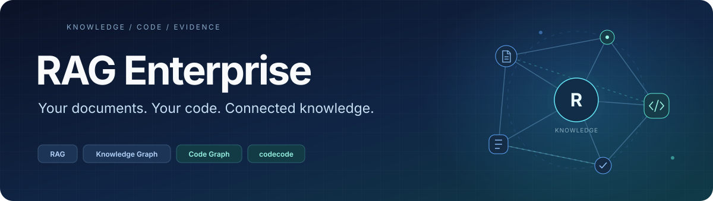
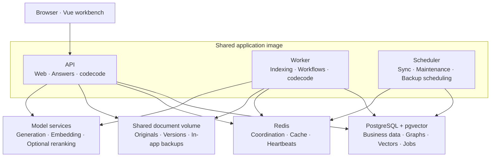

<p align="center">
  
</p>

<p align="center">
  <a href="README.md">简体中文</a> · <strong>English</strong>
</p>

<p align="center">
  <a href="https://github.com/wangchuanbo123/rag-enterprise/actions/workflows/verify.yml"></a>
  <a href="LICENSE"></a>
  
  
  
</p>

<p align="center">
  <a href="#capabilities">Capabilities</a> · <a href="#quick-start">Quick start</a> · <a href="#architecture">Architecture</a> · <a href="#development-and-verification">Development and verification</a> · <a href="docs/README.md">Full guide (中文)</a>
</p>

---

## Make knowledge searchable, connected, and verifiable

**RAG Enterprise** is a team knowledge base and RAG workbench that brings document management, cited answers, knowledge graphs, code graphs, and knowledge agents into one workspace.

Teams can collaborate around the same knowledge, from uploading documents and tracing code dependencies to checking answer citations and reviewing graph changes. A Vue frontend, FastAPI backend, and PostgreSQL + pgvector form the application, with Redis coordinating background work and shared caching.

## Capabilities

| | Capability | What your team can do |
| :---: | --- | --- |
| 📚 | **Documents and sources** | Upload PDF, DOCX, Markdown, HTML, and TXT; manage folders, tags, and versions; synchronize Git repositories, local directories, and S3 |
| 💬 | **Retrieval and answers** | Combine vector search with Chinese BM25 retrieval; use streaming conversations, source citations, scope filters, and retrieval diagnostics |
| 🕸️ | **Knowledge graphs** | Explore entities, relationships, and source evidence; filter graphs with natural language principles and save personal views |
| 🧩 | **Code graphs** | Build code snapshots from Git, directories, or ZIP files; search symbols and inspect source lines, call dependencies, and snapshot differences |
| 🛠️ | **Unified graph governance** | Govern document and code graphs through dedicated tabs: schemas, manual corrections, build jobs, parsing issues, and vector index maintenance |
| ✨ | **Knowledge agents** | Use codecode for extraction, orchestration, governance, evaluation, and analysis; inspect evidence, execution events, usage, and action records |
| 👥 | **Team access** | Review registration requests, approve accounts, assign knowledge base owner / editor / viewer permissions, and manage users and members |
| 📦 | **Operations and recovery** | Track progress, cancel or retry jobs, monitor components and resources, restore knowledge base versions, and create full server backups |

### A complete workflow

> Configure models → Sign in as an administrator → Review registrations → Grant knowledge base access → Upload or synchronize content → Wait for indexing → Ask questions and verify evidence

Use **Knowledge graph** and the **Code graph** entry immediately below it for everyday browsing. Build, correction, and maintenance tools are grouped under the **Document graph / Code graph** tabs in **Graph governance**.

## Quick start

### 1 · Prepare your environment and configuration

You need **Docker Engine + Compose V2**, **Python 3.11+** on the host, and **generation and embedding services** reachable from the containers. On Windows, use Docker Desktop with Linux containers. The first build requires internet access; the application image includes the codecode runtime, while inference is provided by your configured model services.

```bash
git clone https://github.com/wangchuanbo123/rag-enterprise.git
cd rag-enterprise
python -m scripts.configure_server
```

This creates a private `.env.server` file and generates credentials for the initial administrator, JWT, PostgreSQL, and Redis. An existing configuration file is preserved.

### 2 · Configure model APIs and keys

Edit `.env.server` in the project root and replace the placeholders below with your service details. See the [server configuration template](deploy/server.env.example) for all options.

```dotenv
LLM_PROVIDER=openai_compatible
LLM_MODEL=your-chat-model
LLM_BASE_URL=https://your-model-api.example/v1
LLM_API_KEY=replace-with-your-llm-key

EMBEDDING_PROVIDER=openai_compatible
EMBEDDING_MODEL=your-embedding-model
EMBEDDING_BASE_URL=https://your-embedding-api.example/v1
EMBEDDING_API_KEY=replace-with-your-embedding-key

RERANKER_PROVIDER=none
```

For models running on the host, use an address reachable from the containers, such as `http://host.docker.internal:11434`. Changing the embedding model used by an existing index requires rebuilding its vector index.

### 3 · Start the application

```bash
python -m scripts.start_server --no-browser
```

Open **[http://127.0.0.1:8080](http://127.0.0.1:8080)** and sign in with `INITIAL_ADMIN_USERNAME` and `INITIAL_ADMIN_PASSWORD` from `.env.server`. On Windows, you can also double-click [`start.cmd`](start.cmd).

After signing in, open **Run status (运行状态)** and click **Verify model connection (验证模型连接)** before creating a knowledge base and uploading documents. New members request registration on the login page; an administrator reviews requests in **User management (用户管理)**, then grants knowledge base membership after approval.

<details>
<summary><strong>Existing data, team access, and configuration changes</strong></summary>

- By default, startup checks for legacy local data and imports it when needed, preserving source files. For a new empty instance, use `--no-legacy-import`. Migration details are in the [full guide (中文)](docs/README.md).
- For LAN access, set `APP_BIND_ADDRESS=0.0.0.0`. For public deployment, use an HTTPS reverse proxy and configure `COOKIE_SECURE` and `CORS_ORIGINS`.
- After editing `.env.server`, recreate the application containers:

```bash
docker compose --env-file .env.server -f deploy/compose.yml up -d --force-recreate api worker scheduler
```

</details>

## Configuration reference

| Setting | Purpose |
| --- | --- |
| `.env.server` | **Configuration read by Docker deployments**, including model APIs, keys, and server settings |
| `LLM_*` | Default generation model provider, model, base URL, and API key |
| `ANSWER_LLM_*` / `REWRITE_LLM_*` / `ROUTER_LLM_*` | Override defaults for answering, query rewriting, and routing |
| `EMBEDDING_*` / `RERANKER_*` | Embedding model and optional reranker |
| `CODECODE_*` | codecode service address, model, authentication, and runtime settings |
| `AUTH_REGISTRATION_*` | Registration limits by username, source IP, and time window |

`.env` serves local compatibility mode; standard Docker deployments use `.env.server`. Real configuration files, secrets, runtime data, and build outputs are covered by Git ignore rules.

## Architecture

**One application image, three application roles, five containers.** The API handles the web interface and live requests, the Worker executes longer jobs, and the Scheduler arranges recurring work.



Model inference comes from external APIs or separately deployed inference services. See the [five-container architecture guide (中文)](docs/五容器架构与职责说明.md) for service responsibilities, persistent volumes, and recovery boundaries.

## Development and verification

Frontend development requires **Node.js ≥ 22.12**; Docker and CI use Node.js 24. For backend development, create and activate a Python virtual environment, then run from the project root:

```bash
python -m pip install -c constraints-server.txt -r requirements.txt
python -m scripts.prepare_codecode --install-runtime
python -m pytest -q --disable-warnings
```

Run frontend unit tests, the production build, and browser regression tests:

```bash
cd web
npm ci
npm run test
npm run build
npx playwright install chromium
npm run test:e2e
```

Backend PostgreSQL / Redis integration tests and real model acceptance tests require the corresponding services and explicit configuration. See the [full guide (中文)](docs/README.md) for development, retrieval evaluation, and concurrency acceptance procedures.

## Documentation

| Document | Contents |
| --- | --- |
| [User and operations guide (中文)](docs/README.md) | Deployment, workflows, upgrades, backup and recovery, troubleshooting, and evaluation |
| [Five-container architecture (中文)](docs/五容器架构与职责说明.md) | Service responsibilities, storage, and operational boundaries |
| [Server configuration template](deploy/server.env.example) | Environment variables for team deployments |
| [Local configuration template](.env.example) | Local compatibility mode and advanced settings |
| [API documentation](http://127.0.0.1:8080/docs) | Interactive API reference available after startup |
| [Continuous integration](.github/workflows/verify.yml) · [Image releases](.github/workflows/release.yml) | Regression tests, production image verification, and release workflows |

<details>
<summary><strong>Project layout</strong></summary>

```text
rag-enterprise/
├── app/             # APIs, access control, business services, and job execution
├── rag/             # Parsing, retrieval, generation, graphs, and model adapters
├── web/             # Vue workbench and frontend tests
├── deploy/          # Docker Compose and server configuration
├── scripts/         # Startup, migration, backup, diagnostics, and evaluation
├── migrations/      # Database migrations
├── integrations/    # codecode runtime manifests and dependency licenses
├── tests/           # Backend tests
└── docs/            # User guides, architecture, and documentation assets
```

</details>

## License

This project is licensed under the [Apache License 2.0](LICENSE). Included dependencies retain their respective licenses; see [LICENSE.upstream](integrations/codecode/LICENSE.upstream) for the codecode runtime's upstream license.
