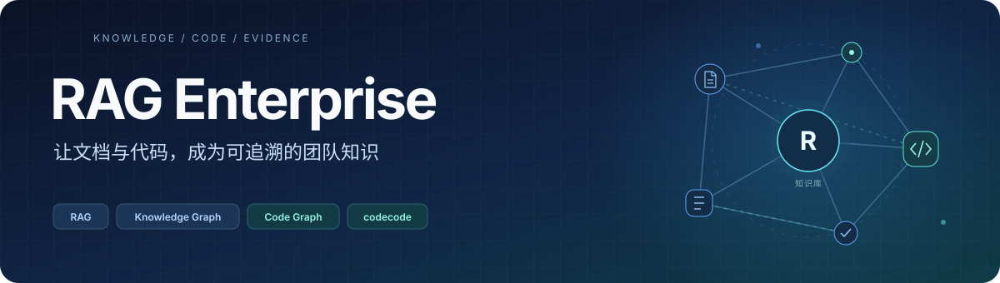
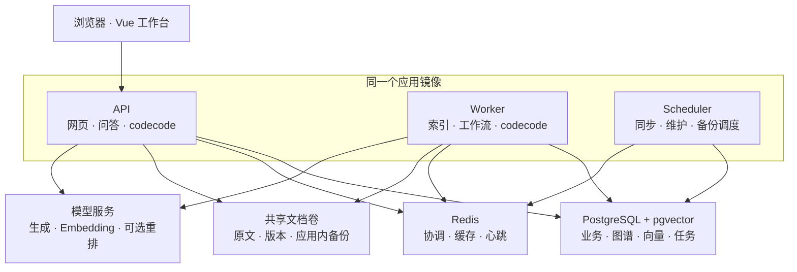

<p align="center">
  
</p>

<p align="center">
  <strong>简体中文</strong> · <a href="README.en.md">English</a>
</p>

<p align="center">
  <a href="https://github.com/wangchuanbo123/rag-enterprise/actions/workflows/verify.yml"></a>
  <a href="LICENSE"></a>
  
  
  
</p>

<p align="center">
  <a href="#核心能力">核心能力</a> · <a href="#快速开始">快速开始</a> · <a href="#系统架构">系统架构</a> · <a href="#开发与验证">开发与验证</a> · <a href="docs/README.md">完整使用指南</a>
</p>

---

## 让知识可检索、可关联、可核验

**RAG Enterprise** 是面向团队的知识库与 RAG 工作台，将文档管理、带来源的问答、知识图谱、代码图谱和知识智能体放在同一个工作空间。

从上传资料到追踪代码依赖，从核对答案引用到审核图谱修订，团队可以围绕同一份知识持续协作。Vue 前端、FastAPI 后端与 PostgreSQL + pgvector 组成应用主体，Redis 协调后台任务和共享缓存。

## 核心能力

| | 能力 | 团队可以做什么 |
| :---: | --- | --- |
| 📚 | **文档与数据源** | 上传 PDF、DOCX、Markdown、HTML、TXT；管理目录、标签和版本；同步 Git、本地目录与 S3 |
| 💬 | **检索与问答** | 向量与中文 BM25 混合检索、多轮流式问答、来源引用、范围筛选和检索调试 |
| 🕸️ | **知识图谱** | 查看实体、关系与原文证据；用自然语言原则筛选图谱并保存个人视图 |
| 🧩 | **代码图谱** | 从 Git、目录或 ZIP 构建代码快照；检索符号、查看源码行号、调用依赖和快照差异 |
| 🛠️ | **统一图谱治理** | 分别治理文档与代码图谱：Schema、人工修订、构建任务、解析问题和向量索引维护 |
| ✨ | **知识智能体** | 通过 codecode 执行抽取、编排、治理、评测和分析；查看证据、执行事件、用量与动作记录 |
| 👥 | **团队权限** | 注册申请、管理员审核、知识库 owner / editor / viewer 权限、账号与成员管理 |
| 📦 | **运维与恢复** | 任务进度、取消重试、组件与资源监控、知识库版本回退及完整服务器备份 |

### 一条完整的使用路径

> 配置模型 → 管理员登录 → 审核注册申请 → 分配知识库权限 → 上传或同步资料 → 等待索引 → 提问并核对证据

日常浏览使用“知识图谱”和其下方的“代码图谱”；构建、修订与维护统一进入“图谱治理”的**文档图谱 / 代码图谱**页签。

## 快速开始

### 1 · 准备环境与配置

需要 **Docker Engine + Compose V2**、宿主机 **Python 3.11+**，以及容器可访问的**生成模型与 Embedding 服务**。Windows 使用 Docker Desktop 的 Linux 容器。首次构建需要联网；应用镜像包含 codecode 运行时，模型推理由配置的服务提供。

```bash
git clone https://github.com/wangchuanbo123/rag-enterprise.git
cd rag-enterprise
python -m scripts.configure_server
```

命令会创建私有 `.env.server`，自动生成初始管理员、JWT、数据库和 Redis 的凭据；已有配置文件会保留。

### 2 · 填写模型 API 与密钥

编辑根目录 `.env.server`，将以下占位值替换为实际服务信息。完整选项见[服务器配置示例](deploy/server.env.example)。

```dotenv
LLM_PROVIDER=openai_compatible
LLM_MODEL=your-chat-model
LLM_BASE_URL=https://your-model-api.example/v1
LLM_API_KEY=replace-with-your-llm-key

EMBEDDING_PROVIDER=openai_compatible
EMBEDDING_MODEL=your-embedding-model
EMBEDDING_BASE_URL=https://your-embedding-api.example/v1
EMBEDDING_API_KEY=replace-with-your-embedding-key

RERANKER_PROVIDER=none
```

模型运行在宿主机时，使用容器可达地址，例如 `http://host.docker.internal:11434`。更换已有索引使用的 Embedding 模型后，需要重建对应向量索引。

### 3 · 启动并打开工作台

```bash
python -m scripts.start_server --no-browser
```

打开 **[http://127.0.0.1:8080](http://127.0.0.1:8080)**，使用 `.env.server` 中的 `INITIAL_ADMIN_USERNAME` 与 `INITIAL_ADMIN_PASSWORD` 登录。Windows 也可双击 [`start.cmd`](start.cmd)。

首次登录后，在“运行状态”点击“验证模型连接”，再创建知识库并上传资料。新成员通过登录页申请注册，由管理员在“用户管理”审核；审核通过后，再分配知识库成员权限。

<details>
<summary><strong>已有数据、团队访问与配置修改</strong></summary>

- 默认启动会检查并按需导入旧的本地数据，保留源文件；全新空实例可使用 `--no-legacy-import`。迁移步骤见[完整使用指南](docs/README.md)。
- 内网访问可设置 `APP_BIND_ADDRESS=0.0.0.0`；对外部署使用 HTTPS 反向代理，并配置 `COOKIE_SECURE` 与 `CORS_ORIGINS`。
- 修改 `.env.server` 后，重新创建应用容器：

```bash
docker compose --env-file .env.server -f deploy/compose.yml up -d --force-recreate api worker scheduler
```

</details>

## 配置速查

| 配置 | 用途 |
| --- | --- |
| `.env.server` | **Docker 部署读取的配置文件**，保存模型 API、密钥与服务器设置 |
| `LLM_*` | 默认生成模型的 provider、model、base URL 和 API key |
| `ANSWER_LLM_*` / `REWRITE_LLM_*` / `ROUTER_LLM_*` | 按回答、查询改写、路由覆盖默认模型配置 |
| `EMBEDDING_*` / `RERANKER_*` | 向量模型与可选重排模型 |
| `CODECODE_*` | codecode 地址、模型、认证与运行时设置 |
| `AUTH_REGISTRATION_*` | 注册申请的用户名、来源 IP 和时间窗口限额 |

`.env` 用于本地兼容模式；常规 Docker 部署使用 `.env.server`。真实配置、密钥、运行数据和构建产物均已加入 Git 忽略规则。

## 系统架构

**一个应用镜像，三个应用角色，五个容器。** API 处理网页与实时请求，Worker 执行耗时任务，Scheduler 安排周期工作。



模型服务由外部 API 或另行部署的推理服务提供。容器职责、持久卷和恢复边界见[五容器架构与职责说明](docs/五容器架构与职责说明.md)。

## 开发与验证

前端开发需要 **Node.js ≥ 22.12**，Docker / CI 使用 Node.js 24。后端开发先创建并激活 Python 虚拟环境，随后在项目根目录执行：

```bash
python -m pip install -c constraints-server.txt -r requirements.txt
python -m scripts.prepare_codecode --install-runtime
python -m pytest -q --disable-warnings
```

前端单元测试、构建与浏览器回归：

```bash
cd web
npm ci
npm run test
npm run build
npx playwright install chromium
npm run test:e2e
```

后端 PostgreSQL / Redis 集成测试和真实模型验收需要相应服务与显式配置。开发、检索评测和并发验收见[完整使用指南](docs/README.md)。

## 文档导航

| 文档 | 内容 |
| --- | --- |
| [完整使用与运维指南](docs/README.md) | 部署、网页操作、升级、备份恢复、排错与效果评测 |
| [五容器架构](docs/五容器架构与职责说明.md) | 服务职责、数据存储与运行边界 |
| [服务器配置示例](deploy/server.env.example) | 团队部署的环境变量模板 |
| [本地配置示例](.env.example) | 本地兼容模式与进阶配置 |
| [API 文档](http://127.0.0.1:8080/docs) | 启动服务后查看交互式 API 文档 |
| [持续集成](.github/workflows/verify.yml) · [镜像发布](.github/workflows/release.yml) | 回归测试、生产镜像验证与发布流程 |

<details>
<summary><strong>项目目录</strong></summary>

```text
rag-enterprise/
├── app/             # API、权限、业务服务和任务执行
├── rag/             # 解析、检索、生成、图谱与模型适配
├── web/             # Vue 工作台与前端测试
├── deploy/          # Docker Compose 与服务器配置
├── scripts/         # 启动、迁移、备份、诊断和评测
├── migrations/      # 数据库迁移
├── integrations/    # codecode 运行时清单与依赖许可证
├── tests/           # 后端测试
└── docs/            # 使用指南、架构说明和文档资源
```

</details>

## 许可证

本项目采用 [Apache License 2.0](LICENSE)。所包含的依赖保留各自的许可证，codecode 运行时的上游许可见 [LICENSE.upstream](integrations/codecode/LICENSE.upstream)。
