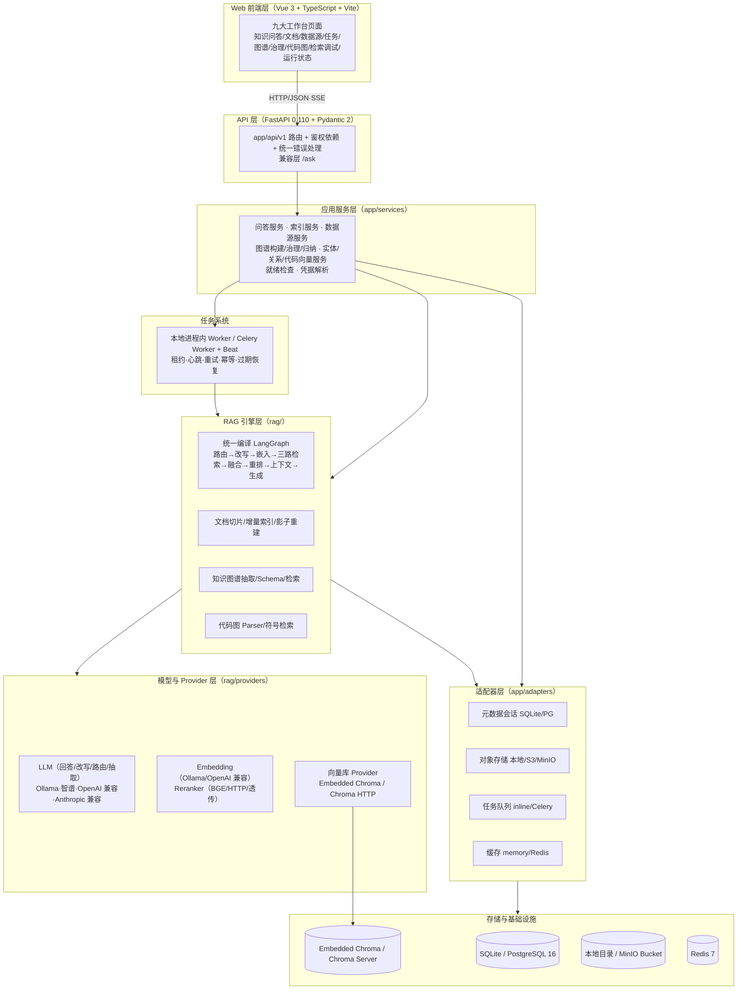
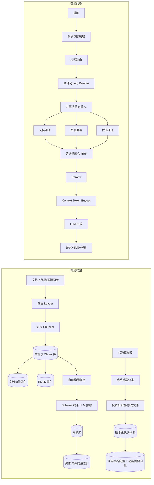
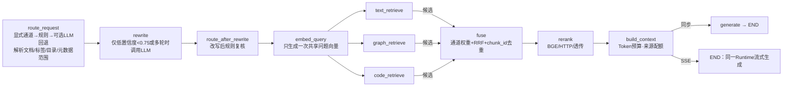

# Enterprise RAG 系统总体说明

> 本文档是系统的总纲性说明，整合了 [README](../README.md)、[部署操作文档](../deploy/部署操作文档.md)、[代码阅读指南](代码阅读指南.md) 与 [RAG 架构图](RAG架构图.puml) 的信息，并基于当前代码实际结构（`app/`、`rag/`、`web/`、`deploy/`）核对整理。
> 适用读者：开发者、运维人员、系统管理员与首次使用者。
> 结论性信息以代码与自动化测试为准；文档编写时 Alembic 唯一 Head 为 `f2d6a8c1e4b7`，Python 全量回归 168 项测试通过。

---

## 目录

1. [系统总览](#1-系统总览)
2. [服务功能边界](#2-服务功能边界)
3. [数据流详解](#3-数据流详解)
4. [部署与迁移](#4-部署与迁移)
5. [使用指南](#5-使用指南)
6. [运维排障与安全](#6-运维排障与安全)
7. [附录：目录结构与文档导航](#7-附录目录结构与文档导航)

---

## 1. 系统总览

### 1.1 系统定位

Enterprise RAG（ragflow-enterprise）是一套**可在本地笔记本和企业服务器上运行的多知识库 RAG 系统**。核心定位：

- **文档问答**：把 Word/PDF/Markdown/TXT/HTML 等文档上传后自动切分 Chunk、建立向量索引与 BM25 索引，问答时检索并生成带引用来源的回答。
- **文档知识图谱**：从文档中抽取实体与关系构建知识图谱，让回答能"顺着关系推理"而不只是文本相似度匹配；提供 Schema 注册、漂移检查、质量门禁、人工校正与消歧合并等治理能力。
- **代码知识图谱**：对 Git/本地目录中的代码做 AST 解析、符号索引、调用图/依赖图，支持代码结构向量与功能摘要向量双路召回。
- **可替换基础设施**：业务服务与模型、数据库、向量库、对象存储、缓存、任务队列完全解耦；同一套业务代码通过配置在 local / enterprise 两种 Profile 之间切换。

一句话：**文档进 → 图谱写 → 问答准**。所有数据（知识库、成员、文档、Chunk、向量、图谱、代码快照、任务、会话）按 `knowledge_base_id` 隔离；角色分为全局管理员、owner、editor、viewer。

### 1.2 总体架构

系统采用分层架构，业务代码（API、服务、LangGraph、Repository、任务处理）在两种 Profile 下完全一致，仅基础设施适配器不同：



**两种部署形态使用同一套业务代码**：

| 能力 | local Profile | enterprise Profile |
| --- | --- | --- |
| 元数据与逻辑图 | SQLite + SQLAlchemy | PostgreSQL + SQLAlchemy |
| 向量库 | Embedded Chroma | Chroma HTTP Server |
| 文件/对象 | `data/docs` 本地目录 | S3/MinIO Bucket |
| 任务队列 | 进程内唤醒 + 持久化任务 | Celery + Redis（任务事实仍在数据库） |
| 缓存 | 进程内 Memory Cache | Redis Cache/PubSub |
| Worker | API 进程内单 Worker | 独立 Celery Worker，可加副本 |
| 定时同步 | 本地 Scheduler | Celery Beat |
| 图存储 | SQLite 图表 | PostgreSQL 上的 SQLAlchemy 图表 |
| 模型 | Ollama、兼容 OpenAI API、本地 BGE | 明确配置的 OpenAI-compatible 网关 + 可选 HTTP Reranker |

> 注意：当前可直接配置切换的企业图存储是 PostgreSQL 上的 SQLAlchemy 图表；Neo4j 和 pgvector 尚未提供经过验收的 Adapter，不能仅改连接串启用。

### 1.3 服务清单

**企业 Compose（`deploy/enterprise/docker-compose.yml`）共 8 个服务：**

| 服务 | 镜像/角色 | 说明 |
| --- | --- | --- |
| `postgres` | postgres:16-alpine | 元数据库（库名 `ragflow`），数据卷 `postgres-data` |
| `redis` | redis:7-alpine（AOF 持久化） | Celery Broker/Backend + 共享缓存，数据卷 `redis-data` |
| `chroma` | chromadb/chroma:0.4.24 | 向量检索服务，持久化目录 `/chroma/chroma` |
| `minio` | minio/minio | 对象存储（Bucket `ragflow`），控制台 9001 |
| `minio-init` | minio/mc | 一次性任务：创建 `ragflow` Bucket |
| `api` | ragflow-enterprise 镜像 | FastAPI 应用 + 托管前端，端口 `${APP_PORT:-8080}` |
| `worker` | 同一镜像 | Celery Worker，队列 `rag.index`，并发 `${WORKER_CONCURRENCY:-2}` |
| `beat` | 同一镜像 | Celery Beat 定时：任务对账（每 30s）、连接器调度（每 60s）、图谱社区维护（默认每 600s；`GRAPH_COMMUNITY_MAINTENANCE_WINDOW` 形如 `22-6` 可限制只在小时间窗执行，空值全天允许） |

**笔记本 Compose（`deploy/laptop/docker-compose.yml`）只有 1 个服务：**

| 服务 | 说明 |
| --- | --- |
| `app` | 单容器内置前端 + API + 进程内 Worker + 连接器 Scheduler；SQLite/嵌入式 Chroma/本地目录/inline 队列全部在命名卷 `ragflow-laptop-data` 内；通过 `host.docker.internal` 访问宿主机 Ollama |

**应用内部逻辑服务（进程内组件）：**

| 组件 | 文件 | 职责 |
| --- | --- | --- |
| 索引 Worker | `app/services/index_worker.py` | 执行持久化任务：租约领取、心跳续约、失败重试、对账恢复 |
| 连接器 Scheduler | `app/services/connector_scheduler.py` | 按同步间隔自动触发数据源增量同步（local 为进程内线程，enterprise 为 Beat + Celery） |
| 图谱维护 Scheduler | `app/services/graph_maintenance.py` | 后台延迟重建过期社区 |
| 就绪检查 | `app/services/readiness_service.py` | 汇总 8 项组件健康状态（带缓存） |

### 1.4 基础设施

**技术栈：**

| 类型 | 当前实现 |
| --- | --- |
| API | FastAPI 0.110、Pydantic 2 |
| Web | Vue 3、TypeScript、Vite |
| 工作流 | LangGraph（所有问答入口共用同一编译图） |
| ORM / Migration | SQLAlchemy 2、Alembic（Head `f2d6a8c1e4b7`） |
| LLM | Ollama、智谱兼容 API、OpenAI-compatible、Anthropic Messages 兼容 |
| Embedding | Ollama 或 OpenAI-compatible Embedding |
| Reranker | BGE CrossEncoder（进程内）、HTTP `/v1/rerank`、Passthrough |
| 向量库 | Embedded Chroma / Chroma HTTP |
| 关键词检索 | rank-bm25 + jieba |
| 任务 | 本地 Worker / Celery + Redis |
| 对象存储 | 本地目录 / S3 / MinIO |
| 代码解析 | Python 标准库 AST；其他语言 Tree-sitter + 确定性规则 emitter |

**本地数据目录布局：**

```text
data/
├── app.db          # 用户、会话、索引元数据和知识图谱（SQLite）
├── docs/           # 原始文档对象存储（local Profile）
└── vector_db/      # Chroma 嵌入式持久化目录
```

**关键环境变量分组**（完整见 `.env.example` 与 `app/core/config.py`）：

| 分组 | 代表变量 | 说明 |
| --- | --- | --- |
| Profile | `APP_PROFILE` | `local` / `test` / `enterprise`，enterprise 下指向本地适配器会启动失败 |
| 存储 Provider | `METADATA_STORE_PROVIDER`、`VECTOR_STORE_PROVIDER`、`OBJECT_STORE_PROVIDER`、`TASK_QUEUE_PROVIDER`、`CACHE_PROVIDER`、`GRAPH_STORE_PROVIDER` | 决定各适配器选择 |
| 数据库 | `DATABASE_URL` | SQLite 或 PostgreSQL 连接串 |
| 模型 | `LLM_PROVIDER/MODEL/BASE_URL/API_KEY`，及 `ANSWER/REWRITE/ROUTER/GRAPH_EXTRACTION_LLM_*` 按角色覆盖 | enterprise 缺配置直接失败，local 允许回退 Ollama |
| Embedding/Reranker | `EMBEDDING_*`、`RERANKER_PROVIDER`（`bge`=进程内加载、`http`=远程、`none`=透传） | 可独立配置 |
| 切片与索引 | `CHUNK_SIZE=384`、`CHUNK_OVERLAP=64`、`MIN_CHUNK_SIZE=80`、`INDEX_SCHEMA_VERSION=2`、`MAX_DOCUMENT_SIZE_MB=50` | 改动影响 chunk_id 确定性生成 |
| 检索 | `VECTOR/BM25/GRAPH/CODE_RETRIEVAL_WEIGHT`（默认 0.50/0.25/0.25/0.25）、`RRF_K=60`、`RERANK_TOP_K=5`、`MAX_CONTEXT_TOKENS=3000`、`MAX_CONTEXT_CHUNKS=5` | 融合权重与上下文预算 |
| 路由与改写 | `RETRIEVAL_ROUTER_MODE=rules`、`ROUTER_LLM_ENABLED=false`、`QUERY_REWRITE_CONFIDENCE_THRESHOLD=0.75` | 规则优先、可选 LLM 回退 |
| 知识图谱 | `GRAPH_AUTO_BUILD_ENABLED`、`GRAPH_SCHEMA_AUTO_GENERATE_ENABLED`、`GRAPH_MIN_CONFIDENCE=0.60`、`GRAPH_MAX_HOPS=1或2`、采样与防抖参数 | 自动构图/自动 Schema 默认开 |
| 代码图谱 | `CODE_GRAPH_ENABLED`、`CODE_VECTOR_ENABLED`、`CODE_FUNCTION_SUMMARY_LLM_ENABLED`、`CODE_SNAPSHOT_RETENTION=3` | 功能摘要可关 LLM 降级为确定性摘要 |
| 任务 | `INDEX_JOB_LEASE_SECONDS=300`、`INDEX_JOB_HEARTBEAT_SECONDS=30`、`INDEX_JOB_MAX_ATTEMPTS=3` | 租约与重试 |
| 初始账号 | `INITIAL_ADMIN_USERNAME/PASSWORD`、`JWT_SECRET_KEY` | local 缺失时自动生成写回 `.env`；enterprise 必须显式提供 |
| 安全 | `CORS_ORIGINS`、`COOKIE_SECURE` | enterprise 默认 `COOKIE_SECURE=true` |

---

## 2. 服务功能边界

### 2.1 分层职责矩阵（负责什么 / 明确不负责什么）

| 层 | 负责 | 明确不负责 |
| --- | --- | --- |
| **Web 前端层**（`web/src/components`） | 九个工作台页面渲染、知识库切换器、SSE 流式展示、检索调试与运行状态可视化 | 不做权限判定（权限以 API 判定为准）、不直连数据库/向量库/模型 |
| **API 层**（`app/api`） | HTTP 路由、JWT Cookie 鉴权（`get_current_user`）、参数校验、统一错误响应、`X-Request-ID` 中间件、CORS | 不含业务逻辑；不做检索编排 |
| **应用服务层**（`app/services`） | 问答编排调用 LangGraph、文档索引任务编排、数据源同步、图谱构建/治理/Schema 归纳、实体/关系/代码向量重建、就绪检查、凭据解析 | 不直接实现检索算法与 LLM 协议细节（下沉到 rag/ 与 providers） |
| **RAG 引擎层**（`rag/`） | LangGraph 工作流与节点、三路检索通道与 RRF 融合、切片与增量索引、图谱抽取/存储/检索、代码图解析与检索、上下文预算与引用 | 不管理 HTTP 会话与用户；不做模型协议 HTTP 细节（交给 providers） |
| **模型/Provider 层**（`rag/providers`） | LLM（4 种角色）、Embedding、Reranker、向量库的抽象接口与实现、按角色路由模型配置 | 不做业务缓存失效、不做任务持久化 |
| **适配器层**（`app/adapters`） | 元数据会话、对象存储、任务队列、缓存的厂商中立接口（`ObjectRef`/`enqueue`/`health`）与 local/remote 实现 | 不含业务语义；不解析文档内容 |
| **任务系统**（`app/services/index_worker.py`、`app/tasks`） | 持久化任务执行、租约领取与心跳、失败项重试、幂等去重、过期任务恢复、Celery 包装与 Beat 调度 | 不决定"该跑什么任务"（由服务层创建） |
| **存储层** | 数据持久化（SQLite/PG、Chroma、本地/S3、Redis） | —— |

**几个重要的边界约定（跨层契约）：**

- 三个检索通道（text/graph/code）**互不写同一个状态字段**；单通道失败会记录状态并允许其余通道继续。
- 代码图谱与文档知识**当前保持独立**：没有建立 `Code Symbol → Document Chunk` 显式关联，也不做代码—文本跨索引扩展。
- 连接器的 `connection_ref` **只保存引用**（`env://VAR` 或 `file://path`），不保存原始凭据。
- 图谱生成结果**始终是草稿**，必须人工审核激活，不会绕过人工审核直接替换活动版本。

### 2.2 接口清单（API）

完整定义以 Swagger（`http://<host>/docs`）为准。前缀 `/api/v1`；`{kb_id}` 即 `knowledge_base_id`。

**兼容与认证：**

| 方法 路径 | 说明 |
| --- | --- |
| `POST /ask` | 默认知识库兼容问答（仍要求登录） |
| `POST /api/v1/auth/login` | 登录，设置 HttpOnly JWT Cookie |
| `POST /api/v1/auth/logout` | 退出，清除 Cookie |
| `GET /api/v1/auth/me` | 当前用户 |

**会话与消息：**

| 方法 路径 | 说明 |
| --- | --- |
| `POST/GET /api/v1/conversations` | 新建/列出会话（按知识库隔离） |
| `GET/PATCH/DELETE /api/v1/conversations/{id}` | 会话详情/重命名/删除 |
| `POST /api/v1/conversations/{id}/messages` | 同步问答消息 |
| `POST /api/v1/conversations/{id}/messages/stream` | SSE 流式问答 |

**知识库与问答：**

| 方法 路径 | 说明 |
| --- | --- |
| `GET/POST /api/v1/knowledge-bases` | 列出/创建知识库 |
| `GET /api/v1/knowledge-bases/{kb_id}` | 知识库详情 |
| `GET/PUT/DELETE .../{kb_id}/members[/{user_id}]` | 成员管理（viewer/editor） |
| `GET/POST .../{kb_id}/sources`、`PATCH/DELETE .../sources/{source_id}` | 数据源 CRUD |
| `POST .../sources/{source_id}/check` / `.../sync` | 数据源配置检查/手动同步 |
| `POST .../{kb_id}/ask` | 知识库级问答（同步） |
| `POST .../{kb_id}/retrieval/debug` | 检索调试（只跑检索不生成） |

**文档管理：**

| 方法 路径 | 说明 |
| --- | --- |
| `GET/POST .../{kb_id}/documents` | 列出/上传文档 |
| `POST .../{kb_id}/documents/batch-upload` | 批量上传（≤100 文件、≤500MB） |
| `GET/DELETE .../documents/{document_id}` | 详情/删除 |
| `POST .../documents/{document_id}/reindex` | 重建单文档索引 |
| `POST .../{kb_id}/documents/batch` | 批量操作（删除/重建/移动/打标签） |
| `GET/PUT .../documents/{document_id}/tags` | 文档标签 |
| `GET .../documents/{document_id}/chunks` | Chunk 列表 |
| `GET/POST .../documents/{document_id}/versions`、`POST .../versions/{version_id}/restore` | 不可变版本历史/上传新版本/恢复 |
| `GET/POST .../{kb_id}/folders`、`GET/POST .../{kb_id}/tags` | 目录与标签管理 |
| `GET .../{kb_id}/documents/tag-map` | 标签到文档映射 |
| `GET .../documents/{document_id}/subgraph` | 文档级知识子图 |

**索引任务（默认 KB 兼容入口为 `/api/v1/index-jobs/*`）：**

| 方法 路径 | 说明 |
| --- | --- |
| `POST .../{kb_id}/index-jobs/sync` | 手动触发本地目录/Git 增量同步 |
| `GET .../{kb_id}/index-jobs`、`GET .../index-jobs/{job_id}` | 任务列表/详情 |
| `GET .../index-jobs/{job_id}/events` | 任务事件流 |
| `POST .../index-jobs/{job_id}/cancel` / `.../retry` | 取消/失败项重试 |

**知识图谱查看（默认 KB 兼容入口 `/api/v1/knowledge-graph/*`）：**

| 方法 路径 | 说明 |
| --- | --- |
| `GET .../{kb_id}/knowledge-graph/stats` | 实体/关系/提及/证据统计 |
| `GET .../knowledge-graph/entities`、`GET .../entities/{entity_id}` | 实体列表/详情 |
| `GET .../entities/{entity_id}/neighbors` | 邻居关系 |
| `GET .../{kb_id}/knowledge-graph/subgraph` | 实体两跳子图 |

**图谱治理（`graph_governance.py`，均在 `/{kb_id}/knowledge-graph/` 下）：**

| 路径（省略前缀） | 说明 |
| --- | --- |
| `GET/POST schemas`、`PUT schemas/{schema_id}` | Schema 版本列表/新建/编辑 |
| `POST schemas/generate` | 基于文档采样生成 Schema 草稿 |
| `POST schemas/drift-check` | Schema 漂移检查（仅新类型产生建议草稿） |
| `GET schemas/{schema_id}/impact` | 激活影响评估 |
| `POST schemas/{schema_id}/activate` | 激活（事务内旧版本转 superseded） |
| `GET/PUT automation` | 自动构图/自动 Schema 开关 |
| `POST build` | 快速/标准/深度三档构建 |
| `GET/POST quality` | 质量门禁检查 |
| `GET coverage` | 文档级图谱覆盖报告 |
| `GET entity-vector`、`POST entity-vector/rebuild` | 实体向量状态/重建 |
| `GET relation-vector`、`POST relation-vector/rebuild` | 关系向量状态/重建 |
| `GET/POST corrections`、`POST corrections/{id}/revert`、`POST corrections/reconcile` | 人工校正/回退/对账 |
| `GET reviews`、`POST reviews/{review_id}/resolve` | 人工复核队列 |
| `GET/POST merges`、`POST merge-candidates/scan`、`POST merges/{merge_id}/revert` | 实体消歧合并/候选扫描/拆分 |
| `GET/POST relation-merges`、`POST relation-merge-candidates/scan`、`POST relation-merges/{merge_id}/revert` | 关系消歧合并 |
| `GET communities`、`GET community-status`、`POST communities/rebuild` | 分层社区 |

**代码图谱：**

| 方法 路径 | 说明 |
| --- | --- |
| `GET .../{kb_id}/code-graph/stats` | 文件/符号/调用/依赖统计 |
| `GET .../code-graph/snapshots` | 版本化快照列表 |
| `POST .../code-graph/index` | 触发代码索引 |
| `GET .../code-graph/symbols` | 词法/向量符号搜索 |
| `GET .../code-graph/vector`、`POST .../code-graph/vector/rebuild` | 代码向量状态/重建 |
| `GET .../code-graph/subgraph` | 调用/依赖子图 |

**健康检查：**

| 方法 路径 | 说明 |
| --- | --- |
| `GET /api/v1/health` | 存活探针 |
| `GET /api/v1/ready` | Provider/模型/索引就绪状态（含 8 项组件检查） |

**命令行入口（`scripts/`）：**

| 命令 | 说明 |
| --- | --- |
| `python -m scripts.ingest_documents` | 默认知识库 CLI：`--dry-run`/`--sync`/`--rebuild`/`--graph-only`/`--retry-failed`/collection 管理 |
| `python -m scripts.evaluate_rag` | RAG 检索/全链路评估与对比 |
| `python -m scripts.evaluate_routing` / `evaluate_model_routing` | 路由规则/真实模型路由评估 |
| `python -m scripts.validate_enterprise_profile --write-check` | 企业部署 Provider 与写入检查 |
| `python -m scripts.bootstrap_empty_environment` | 清空业务数据并初始化干净基线 |

---

## 3. 数据流详解

### 3.1 整体数据流



### 3.2 文档索引数据流（逐步）

1. **入口**：Web 上传（`POST .../documents` 或 `batch-upload`）、数据源同步（本地目录/Git/S3）或 CLI。文件写入对象存储，元数据落 `knowledge_documents`。
2. **任务创建**：`DocumentIndexService` 创建 `index_jobs` + `index_job_items`（幂等去重），入队（inline 唤醒或 Celery）。
3. **Worker 执行**：Worker 领取租约（`INDEX_JOB_LEASE_SECONDS=300`，心跳 30s），调用 `DocumentIndexService` / `IndexManager`。
4. **解析与切片**：`rag/loaders` 按扩展名解析（支持 `.txt .pdf .md .docx .html .htm`）；`rag/indexing/chunker` 按 `CHUNK_SIZE=384`/`CHUNK_OVERLAP=64` 切分（tiktoken 计数），每个 Chunk 生成**确定性 chunk_id**（见 3.6 契约）。
5. **向量写入**：Chunk 批量（`INGEST_BATCH_SIZE=128`）经 Embedding 写入 Chroma collection；BM25 语料同步更新。
6. **指针切换/清理**：全量重建走**影子 collection**（命名 `documents_build_{job_id}`；多知识库隔离场景为 `documents_{kb短id}_build_{job_id}`）：写满 → 校验数量与 ID 一致 → 单事务切换 `knowledge_index_state.active_collection_name` → 保留旧 collection 供回滚。单文件更新先写新向量再清旧向量，失败时旧索引保持可用。
7. **后续任务**：索引成功后按知识库设置自动派生「Schema 归纳任务」（首次）与「增量构图任务」（防抖合并：60s 内上传合并、≥20 个 pending Chunk 或最长等 300s 触发）。

### 3.3 知识图谱数据流

1. **Schema 归纳**：对已解析文档分层采样（默认 ≤30 文档 × 每份 3 个位置 Chunk × 合计 40000 字符），抽取 LLM 输出实体/关系类型与领域约束；结果**始终是草稿**，记录来源文档与采样统计。
2. **人工激活**：管理员在治理页评估影响（影响文档/Chunk/预计 LLM 请求数）后激活；激活事务内旧活动版本转 `superseded`，数据库部分唯一索引拒绝并发产生第二个活动版本。
3. **构图**：读取活动 Schema，把实体类型、关系字典、领域规则写入 Prompt，并用同一 Schema 校验模型输出（JSON、类型白名单、谓词白名单、`local_id`、自环、原文 evidence 校验；一次失败有一次修复重试）。批量抽取（默认 6 Chunk/请求）；`GRAPH_MIN_CONFIDENCE=0.60` 过滤低置信关系；规则预过滤跳过明显无事实 Chunk。
4. **归一化入库**：实体名称/别名归一化 → `kg_entities`/`kg_aliases`/`kg_entity_mentions`/`kg_relations`/`kg_relation_evidence`。所有关系通过 `kg_relation_evidence.chunk_id` 回链原始 Chunk。
5. **派生索引**：实体向量、关系向量（关系文档=主语+谓词+宾语+描述+最多 3 条证据）；人工合并/校正以**可审计 Overlay** 保存，可拆分/回退。
6. **三档构建**（`graph_build_profiles.py`）：
   - **快速**：只抽新增 Chunk，向量增量，社区延迟重建；
   - **标准**：增量 + 失败重试，社区只重建受影响子图；
   - **深度**：全量重抽，向量/社区全量重建（二次确认）。

### 3.4 代码图谱数据流

1. Git/本地目录同步 → 按**相对路径 + SHA-256** 对新旧清单分类：新增/修改文件重新解析，未变化文件直接复用上一快照事实，删除文件不进新快照。
2. Python 用标准库 `ast`；其他语言优先 Tree-sitter（含错误恢复），结果统一转换为文件/符号/关系（contains/imports/calls/extends），不永久保存完整 AST。
3. 全部关系端点重新解析后**原子激活新快照**（保留最近 `CODE_SNAPSHOT_RETENTION=3` 个供查看历史与安全切换）。Parser 版本或数据源变化时自动退化为全量解析。
4. 每个 Symbol 生成两类向量：**结构向量**（语言/路径/类型/限定名/签名/源码片段）与**功能摘要向量**（抽取模型生成中文业务摘要；模型不可用时确定性摘要降级，后续允许重试）。向量 ID 由 `vector_kind + stable_key` 派生；快照激活后仅删已消失 Symbol 的向量、重算变化向量、保留未变化向量；Embedding 配置变化或增量基线不可用时自动影子全量重建。

### 3.5 在线问答数据流（统一 LangGraph）

所有入口（`/ask`、知识库 `/ask`、Web 同步消息、SSE）共用同一份编译工作流：



逐步说明：

1. **route_request**：用户显式通道选择 > 规则关键词路由（关系/依赖/影响→graph；代码/函数/调用→code；默认 text）> 可选 LLM 结构化回退；同时把范围（document_ids/tag_ids/folder_id/metadata）解析为**当前知识库允许的文档 ID 集合**再下推各通道。
2. **rewrite**：仅当路由置信度 < `0.75` 或存在历史消息才调用改写 LLM；改写成功后仅用规则复核意图。
3. **embed_query**：最终语义查询只生成一次向量，文档/实体/关系/代码向量索引统一用 `similarity_search_by_vector`；词法检索仍可用原始+改写双问题。
4. **三通道并行**（`fast`/`standard`/`deep` 三档控制各通道 K 值、跳数、预算，默认 standard）：
   - 文档通道：Chroma 向量 + 中文 BM25 + 多查询召回 → 加权 RRF → 范围过滤 → Chunk 去重；
   - 图谱通道：实体词法（名称/别名/包含）+ 实体向量 + 关系词法（谓词/中英文别名）+ 关系向量 → 种子合并 → 关系作 0 跳事实 + 端点扩展 1～2 跳遍历 → `kg_relation_evidence` 回溯 Evidence Chunk；
   - 代码通道：Symbol 词法（名称/限定名/签名）+ 结构向量 + 功能摘要向量 → 按 Symbol 去重 + RRF → 扩展 calls/imports/extends 事实。
   - 三档策略参数（`rag/retrieval_strategy.py`，基于默认配置换算）：

     | 参数（默认值） | fast | standard | deep |
     | --- | --- | --- | --- |
     | 向量/BM25 K（8/8） | 减半（≥2） | 原值 | 翻倍 |
     | 候选 K（12） | 减半（≥4） | 原值 | 翻倍（24） |
     | 图实体/关系 K（5/8） | 减半（≥2） | 原值 | 翻倍 |
     | 图遍历跳数 | 固定 1 跳 | `GRAPH_MAX_HOPS`（2） | 2 跳 |
     | 图关系上限（50） | 减半（≥10） | 原值 | 翻倍 |
     | 代码 K（12） | 减半（≥4） | 原值 | 翻倍 |
     | 重排 K（5） | -2（≥3） | 原值 | 翻倍 |
     | 上下文 Chunk 数（5） | -2（≥3） | 原值 | +3（8） |
     | 上下文 Token（3000） | ×0.6（≥800） | 原值 | ×1.67（≈5000） |

5. **fuse → rerank → build_context**：跨通道按权重融合（0.50/0.25/0.25/0.25），按 `chunk_id` 去重，重排后做来源配额（每源 ≤2 Chunk）与 Token 预算（3000 × 安全比 0.85）。
6. **generate**：同步请求由 LangGraph 完成生成；SSE 用同一 Graph 准备上下文后从同一 Runtime 流式调用回答模型。回答附带来源、路由理由、通道状态，可解释可核查。
7. **降级**：向量服务异常时在线检索降级为词法召回 + 图遍历，不会使整个问答失败；单通道失败不阻塞其余通道。

### 3.6 共享数据契约与版本一致性规则

**核心标识契约（全链路共享）：**

| 契约 | 规则 | 消费方 |
| --- | --- | --- |
| `document_id` | 文档 UUID | 文档表/Chunk 表/图谱/快照/版本 |
| `file_hash` | 文件内容 SHA-256 | 增量判断、chunk_id 派生、代码文件差异分类 |
| `chunk_id` | `sha256(document_id : file_hash : INDEX_SCHEMA_VERSION : chunk_index)` 确定性生成 | 向量/BM25/图谱 Evidence/融合去重的统一主键 |
| `active_collection_name` | 保存在 `knowledge_index_state`，切换即换指针 | 检索运行时按签名缓存加载 |
| 向量 ID | 文档/实体/关系/代码分别独立**版本化 Chroma Collection**，代码向量 ID 由 `vector_kind + stable_key` 派生 | 切换新索引状态后才清理旧 Collection |
| `kg_relation_evidence.chunk_id` | 所有图谱关系必须回链原始 Chunk | 图谱检索最终以文档证据为准 |
| `ObjectRef(key,size,content_hash)` | 对象存储逻辑引用，调用方不依赖本地路径 | local/S3 适配器统一语义 |
| 任务幂等键 | 持久化 job/item 去重 + 租约（worker_id + lease）+ 心跳 | inline 与 Celery 共用同一执行器 |

**版本一致性规则：**

1. **分类型 Schema 单活动**：每个知识库的通用文档、概念、系统功能、配置项和行业标准图谱分别最多一个活动 Schema；激活只替换同类旧版本。构图时五套活动约束合并为一次抽取，执行版本写入 Chunk，避免重复调用 LLM。
2. **影子切换**：全量重建（文档向量/代码向量/图谱深度）一律先写影子目标、校验数量与 ID 一致、再单事务切换指针；旧目标保留用于回滚。
3. **代码快照原子激活**：关系全部重解析后整体激活新快照；Parser 版本/数据源变化触发全量退化；未变化 Symbol 事实与摘要跨快照复用（含来源指纹、模型指纹比对）。
4. **租约恢复**：API 启动时执行 `recover_expired_leases()`，把租约过期的任务交还对账；Worker 崩溃后任务不丢（`task_acks_late`）。
5. **缓存失效**：索引变化后 `invalidate_rag_caches()` 清理进程内 Runtime/Graph/检索器缓存，并经 Redis PubSub 广播；API 未订阅消费时，数据库签名变化或重启仍保证最终一致（已知边界）。
6. **索引签名（Runtime 缓存键）**：`knowledge_index_state` 上的 `get_index_signature()` 由五要素拼接——`活动 collection 名 | index_schema_version | embedding_fingerprint | corpus_fingerprint | updated_at`。RAGRuntime 每次请求前比对当前签名，签名变化即重建检索器与编译图，这是跨进程最终一致的兜底机制。

**主要数据表（`app/models/`）：**

| 域 | 表 |
| --- | --- |
| 用户/会话 | `users`、`conversations`、`messages` |
| 知识库 | `knowledge_bases`、`knowledge_base_members`、`knowledge_data_sources` |
| 文档管理 | `knowledge_documents`、`knowledge_chunks`、`knowledge_folders`、`document_tags`、`document_tag_links`、`document_versions` |
| 索引任务 | `knowledge_index_state`、`index_jobs`、`index_job_items`、`index_job_events` |
| 知识图谱 | `kg_entities`、`kg_aliases`、`kg_entity_mentions`、`kg_relations`、`kg_relation_evidence`、`kg_graph_corrections` |
| 图谱治理 | `graph_schema_definitions`、`graph_extraction_cache`、`graph_quality_reports`、`kg_entity_merges`、`graph_review_items`、`graph_communities`、`graph_community_states`、`graph_community_members` |
| 代码图谱 | `code_snapshots`、`code_files`、`code_symbols`、`code_relations`、`entity_vector_index_state`、`relation_vector_index_state`、`code_vector_index_state` |

> 模型变更必须同时检查 `app/models/`、`app/models/__init__.py` 和 `migrations/versions/`。

---

## 4. 部署与迁移

### 4.1 部署形态选择

| 场景 | 入口 | 进程拓扑 |
| --- | --- | --- |
| 本地开发（无 Docker） | `uvicorn app.main:app` | 单进程：API + 进程内 Worker + Scheduler |
| 笔记本 Docker | `deploy/laptop/deploy.ps1` | 单容器（local Profile） |
| 企业服务器 | `deploy/enterprise/deploy.sh` | 8 服务 Compose（enterprise Profile） |

### 4.2 本地开发环境搭建

```powershell
# 1. Python 3.11 虚拟环境
py -3.11 -m venv venv
.\venv\Scripts\Activate.ps1
python -m pip install --upgrade pip
pip install -r requirements.txt

# 2. 配置
if (-not (Test-Path .env)) { Copy-Item .env.example .env }
# 最小 local Profile：APP_PROFILE=local、sqlite、chroma_embedded、local、inline、memory

# 3. 本地模型（默认 Ollama Embedding）
ollama pull nomic-embed-text-v2-moe

# 4. 启动后端（自动：Alembic 迁移→初始管理员→租约恢复→进程内 Worker/Scheduler）
python -m uvicorn app.main:app --host 127.0.0.1 --port 8000 --reload

# 5. Web 开发服务
cd web; npm install; npm run dev     # http://localhost:5173
# 或生产式：npm run build 后 FastAPI 自动托管 web/dist
```

常用地址：`http://127.0.0.1:8000`（Web/API）、`/docs`（Swagger）、`/api/v1/health`、`/api/v1/ready`。初始管理员与 JWT 密钥为空时自动生成并写回 `.env`。

### 4.3 改代码后重新部署

**原则：两种 Profile 共用业务代码和镜像构建文件，改代码 = 重建镜像 = 滚动重启应用容器；数据卷不动。**

本地开发（热重载）：

```powershell
# uvicorn --reload 已自动生效；手工迁移数据库：
.\venv\Scripts\python.exe -m alembic upgrade head
```

笔记本 Docker：

```powershell
powershell -ExecutionPolicy Bypass -File .\deploy\laptop\deploy.ps1 -Action Up      # 会重新 build 镜像并重启
# 其他动作：Status / Logs / Validate / Restart / Down
```

企业服务器：

```bash
bash deploy/enterprise/deploy.sh up        # 重新构建镜像 → 启动 8 服务 → 健康检查 → 连通性验证
# 常用：status / logs / validate / restart / down
# 仅更新应用不动物理库：
docker compose --env-file deploy/enterprise/.env -f deploy/enterprise/docker-compose.yml up -d --build api worker beat
```

注意事项：

- **数据库结构变化**必须新增 Alembic 迁移并在启动时自动升级（应用启动 lifespan 会执行迁移）。
- `down` 只删容器和网络，**不删命名卷**；不要随意 `docker compose down -v`（会清空数据库/向量库/对象存储）。
- 通常不需要修改 Compose 与 `Dockerfile.enterprise`；生产环境建议用 Compose override 文件而不是改基础文件。

### 4.4 迁移到新电脑

**本地开发环境迁移：**

1. 新机安装 Python 3.11、Node.js/npm、（可选）Ollama；
2. 克隆/复制项目代码（**不要**复制 `venv/`，跨机不兼容）；
3. 重建虚拟环境并安装依赖（同 4.2）；
4. 复制 `.env`（含密钥与初始管理员密码）或从 `.env.example` 重建；本地缺失的 `JWT_SECRET_KEY`/`INITIAL_ADMIN_PASSWORD` 会自动重新生成（生成的是新密码，注意记录）；
5. 想保留本地业务数据：一并迁移 `data/` 目录（`app.db` + `docs/` + `vector_db/`）；只要代码则空 `data/` 重新初始化；
6. 启动后端，执行 `alembic upgrade head`（启动时也会自动跑）。

**笔记本 Docker 部署迁移：**

- 数据全部在命名卷 `ragflow-laptop-data`。新机装 Docker Desktop + Ollama（`ollama pull qwen3:4b`、`ollama pull nomic-embed-text-v2-moe`），复制项目目录，把旧机卷导出/导入（`docker run --rm -v ragflow-laptop-data:/data -v ${PWD}:/backup alpine tar czf /backup/ragflow-data.tgz /data`，新机反向恢复），或直接重新部署后重新上传文档。

**迁移到企业服务器（重点）：**

- **当前没有本地 → 企业的自动数据搬迁工具**，且企业迁移不要求复制本地文档或索引。正确做法：在空服务器初始化后**重新上传文档、重建索引**。
- 首次企业验收应使用**空数据库和空 Bucket**，按「登录 → 新建知识库 → 上传新文档 → 索引 → 可选构图/代码图 → `/ask` 与 Web SSE」端到端验证，不要挂载本地 `data/`。
- 首次部署：`cp .env.example .env` 后填写 PostgreSQL/MinIO/JWT/初始管理员强密码、模型端点、`CORS_ORIGINS`，再 `bash deploy/enterprise/deploy.sh up`；启动后执行 `docker compose ... exec api python -m scripts.validate_enterprise_profile --write-check` 做 Provider 与写入检查。
- 企业环境要求：64 位 Linux、Docker Engine + Compose v2，建议 8 核 / 16GB 内存 / 100GB 可扩展磁盘；模型不包含在 Compose 中，需自备企业模型网关。

---

## 5. 使用指南

> 本节为操作速览（界面按钮名称与系统实际显示一致）。

### 5.1 登录与访问

| 项目 | 说明 |
| --- | --- |
| 访问地址 | 本地开发 `http://127.0.0.1:8000`；Docker 部署默认 `http://localhost:8080`（`APP_PORT` 可改，样例环境为 9090）；局域网用 `http://<部署机IP>:<端口>` |
| 用户名 | `admin`（初始管理员，Docker 部署密码在 `deploy/laptop/.env` 的 `INITIAL_ADMIN_PASSWORD`） |
| 知识库隔离 | 顶部知识库切换器，所有页面数据隶属于当前知识库 |

### 5.2 五分钟快速上手

1. **登录**：浏览器打开地址，输入 admin 和密码。
2. **创建知识库**（Docker/多库场景）：知识库切换器 → 新建；本地开发默认已初始化 1 个默认知识库，可直接用。
3. **上传文档**：「文档管理」→「批量上传」→ 等状态 `processing` → `ready`（`.txt .pdf .md .docx .html .htm`，单文件 ≤50MB）。内容更新走文档详情的「版本历史 → 上传新版本」，不要删了重传。
4. **构建图谱**（可选但推荐；默认自动构图 + 自动 Schema 都开，可跳过手动步骤）：
   - 手动路径：「图谱治理」→「Schema 与抽取约束」→「生成 Schema 草稿」（全部已就绪文档自动采样 ≤30 份，或按文件名/目录/标签手动勾选 ≤100 份）→ 等待完成 → 版本列表点「激活」（弹窗显示影响文档/Chunk/预计 LLM 请求数）→ 顶部「快速」构建；
   - 进度到「索引任务」页看（5 秒自动刷新）。
5. **提问**：「知识问答」→ 输入问题回车（Enter 发送、Shift+Enter 换行）→ 回答上方灰色小条显示路由通道/档位/置信度 → 「▸ 引用来源」展开核实出处。

### 5.3 九大页面速览

| 页面 | 用途 | 要点 |
| --- | --- | --- |
| 知识问答 | 对话主界面 | 会话按知识库隔离；策略下拉：快速（省 token 事实题）/标准（默认）/深度（复杂推理）；失败可重试 |
| 文档管理 | 上传/查看/删除 | 状态筛选；批量重建/删除；详情三标签：Chunk / 版本历史 / 文档子图 |
| 数据源与成员 | Git/S3/本地目录接入；成员管理 | 凭据用 `env://` 或 `file://` 引用；自动同步间隔（0=手动）；源端删除策略；角色 Viewer/Editor |
| 索引任务 | 后台任务进度 | queued/running/completed/failed；失败重试；排队/运行可取消；「同步本地目录」手动增量 |
| 知识图谱 | 可视化浏览 | 按文档看子图 / 搜索实体展开两跳；点连线看原文证据与置信度；可改关系类型/隐藏关系（填原因进审计） |
| 图谱治理 | 治理中枢（进阶） | 构建策略三档；质量门禁「立即检查」；派生索引（实体/关系向量、社区）重建；Schema 版本管理/漂移检查；文档级覆盖报告（处理完成率 vs 事实覆盖率，`no_facts` 不算失败）；人工编辑子图（Overlay 可回退）；治理四件套：复核队列/校正历史/实体消歧合并/关系消歧合并 |
| 代码图谱 | 代码仓库建图（开发者向） | 选 Git/本地目录数据源构建；统计卡；符号搜索看调用/依赖子图；构 建 后检索调试勾 code 通道 |
| 检索调试 | 只跑检索不生成 | 输入问题→勾通道（text/graph/code）→选档位→选范围→看路由解释/引用候选/最终上下文预览 |
| 运行状态 | 8 项组件体检 | 元数据库/对象存储/任务队列/缓存/向量库/模型配置/本地模型服务/索引 Worker；点「重新检查」手动刷新 |

### 5.4 典型排查路径（来自使用手册 FAQ）

- **问答没引用到想要的文档**：① 文档状态 ready？② 检索调试跑同一问题看候选是否为空 → ③ 查范围/通道勾选 → ④ graph 空 → 查图谱覆盖报告 → ⑤ 候选有但预览没有 → 换深度档。
- **文档 ready 但图谱为空**：确认是否有 active Schema；`graph_rebuild` 任务是否 completed（限流下可能 partial）。
- **图谱实体/关系错了**：知识图谱页看证据与置信度 → 隐藏/修改关系；实体名到治理页人工编辑；同一实体中英文两名 → 实体消歧与合并（可拆分）。
- **深度构建何时用**：Schema 大改或图谱整体混乱时；全量 LLM、全量向量与社区重建，耗时成本最高，有二次确认。

---

## 6. 运维排障与安全

### 6.1 运维监控

- **就绪检查**：`GET /api/v1/ready`（或 Web「运行状态」页）覆盖 8 项组件；带 10s 缓存。
- **任务观测**：「索引任务」页 / `index_jobs` 表 / `index_job_events` 事件流；租约与心跳保证 Worker 崩溃后任务可恢复；API 启动自动恢复过期租约。
- **请求追踪**：所有响应带 `X-Request-ID` 中间件分配的请求 ID。
- **上下文导出**（默认关，含业务片段慎用）：`CONTEXT_JSON_EXPORT_ENABLED=true` + `CONTEXT_JSON_EXPORT_DIR=data/debug/contexts`，每次问答导出实际上下文 JSON 用于排查。
- **验证脚本**：`deploy.sh validate` / `scripts.validate_enterprise_profile --write-check`；RAG 质量用 `scripts.evaluate_rag`（tuning/holdout 集与基线对比）。

### 6.2 常见故障与处理

| 症状 | 定位与处理 |
| --- | --- |
| 页面大面积报错/任务全卡 | 先看「运行状态」哪个组件挂了；Docker 用 `deploy.sh logs` / `deploy.ps1 -Action Logs` |
| 文档一直 processing | 索引任务页看任务：running 属正常（大文档慢）；failed 看错误重试；卡住先确认索引 Worker 存活 |
| Schema 生成/图谱构建失败 `429 Too Many Requests` | 模型接口限流（外部 API 约束）：等窗口恢复后「标准」构建或任务重试；长期限流换 `.env` 中 `LLM_*` 模型配置并重启；限流期间可「新建 Schema 版本」手填类型（不依赖 LLM）再激活 |
| 问答慢/召回差 | 检索调试定位通道；重建对应派生索引（实体/关系向量）；换深度档；检查 `RERANK_TOP_K`/上下文预算配置 |
| 图谱通道空 | 确认 active Schema 存在且 graph_rebuild completed；看文档级覆盖报告 |
| 局域网打不开 | 同一局域网 + 用部署机 IP + 正确端口（不是 localhost） |
| 忘记 admin 密码 | 看 `deploy/laptop/.env` 的 `INITIAL_ADMIN_PASSWORD`（仅初始化时生效；数据库已有账号时改此值不会重置） |
| 企业 API 不生效新代码快照 | 已知边界：Redis 失效广播 API 端尚未订阅消费，依赖索引签名变化或重启 |

### 6.3 安全

**应用内置安全机制：**

| 机制 | 实现 |
| --- | --- |
| 认证 | JWT 存于 **HttpOnly Cookie**（`secure=COOKIE_SECURE`，SameSite：开发 lax / 生产 strict）；所有问答入口（含 `/ask`）都要求登录 |
| 授权 | 全局管理员 / 知识库 owner / editor / viewer 分级；成员按 `knowledge_base_id` 隔离 |
| 密钥管理 | `.env` 被 Git 忽略；local 缺失密钥自动生成写回；enterprise 禁止自动写 `.env`，必须由密钥平台提供 |
| 凭据引用 | 连接器只存 `env://VAR` / `file://path` 引用，不落原始凭据 |
| 文件安全 | `safe_filename` 阻止路径穿越与 Windows 保留名；上传大小/批量上限（50MB/100 个/500MB） |
| 本地目录源 | `LOCAL_SOURCE_ALLOWED_ROOTS` 白名单限制可同步目录 |
| Profile 校验 | enterprise 指向本地适配器（sqlite/embedded chroma/local/inline/memory）直接启动失败，防止静默降级 |
| 模型隔离 | 回答/改写/路由/抽取四角色可独立配置模型与密钥 |

**生产上线前应补齐（摘自部署文档）：**

1. API 前加 Nginx/Traefik/Ingress：HTTPS、证书、请求体大小限制；只开放 80/443，不直接暴露 PostgreSQL/Redis/Chroma/MinIO；
2. `.env` 密钥迁移到 Docker Secrets / Vault / K8s Secret 并定期轮换；
3. PostgreSQL/MinIO/Chroma 备份、恢复演练、容量告警、独立磁盘；固定 MinIO 镜像版本避免 `latest`；
4. 日志采集、指标、链路追踪、告警；模型网关并发/超时/配额/降级策略；
5. 上线前 `deploy.sh validate` + 端到端验收（上传、索引、检索、引用、权限隔离）。

**已知边界（运维应知）：** 尚未完成真实企业 Compose 启动与横向扩缩容验收；真实 Git/S3 凭据联调与全量图谱/向量构建未执行；Metrics/Tracing/集中告警/容量规划/生产灾难演练属收尾项；本地历史数据无自动搬迁工具。

---

## 7. 附录：目录结构与文档导航

```text
app/
├── adapters/              Metadata / Object / Queue / Cache Adapter
├── api/                   FastAPI 路由、鉴权依赖和错误处理
├── bootstrap/             Provider 容器与 Profile 校验
├── core/                  配置、数据库、迁移启动、安全和日志
├── models/                业务、任务、文档图和代码图 ORM
├── repositories/          按知识库隔离的数据访问
├── schemas/               API DTO
├── services/              问答、索引、连接器、图谱和代码图服务
└── tasks/                 Celery Worker 与 Beat 任务

rag/
├── code_graph/            Parser、临时 AST 结果、符号/关系检索
├── context/               上下文预算、引用和调试导出
├── graph/                 统一编译 LangGraph
├── indexing/              文档切片、增量索引和影子重建
├── knowledge_graph/       抽取、Schema、标准化、存储和检索
├── nodes/                 路由、三路检索、融合、重排、上下文和生成节点
├── providers/             模型、Embedding、Reranker、向量和图 Provider
├── retrievers/            Chroma、BM25、图谱、代码图和 RRF
└── runtime/               每知识库 Runtime 与索引签名缓存

web/src/components/        九个 Web 工作台页面及聊天组件
deploy/enterprise/         企业 Docker Compose、deploy.sh
deploy/laptop/             笔记本 Compose、deploy.ps1
migrations/                Alembic 迁移（Head: f2d6a8c1e4b7）
scripts/                   索引、部署检查和评估工具
eval/                      评估集和结果
tests/                     自动化测试（168 项通过）
data/                      本地运行数据，不进入企业镜像
docs/                      开发文档（本目录）
```

**文档导航：**

| 文档 | 内容 |
| --- | --- |
| [README](../README.md) | 安装、启动、配置、常用命令、已知边界 |
| [部署操作文档](../deploy/部署操作文档.md) | 企业/笔记本 Docker 部署细则与上线清单 |
| [代码阅读指南](代码阅读指南.md) | 入口、调用链、常见修改位置 |
| [当前实现状态](当前实现状态.md) | 历史实现状态（旧基线） |
| [RAG架构图.puml](../RAG架构图.puml) | 端到端 PlantUML 架构图（构建/路由/三路检索/融合/生成） |

**验证命令速查：**

```powershell
# 后端全量测试
.\venv\Scripts\python.exe -m pytest -q
# 前端生产检查
cd web; npm run build
# 索引 dry-run / collection 查看
python -m scripts.ingest_documents --dry-run
python -m scripts.ingest_documents --list-collections
# RAG 评估
python -m scripts.evaluate_rag --mode full --split holdout --label final
```

> 本地测试通过不等于企业验收完成；上线前仍需真实 Provider Contract、多 Worker、浏览器 E2E、性能、安全、备份恢复和故障演练。

---

*本文档基于 2026-08 系统当前版本编写；能力边界以代码、自动化测试与 README「已知边界」为准。*
